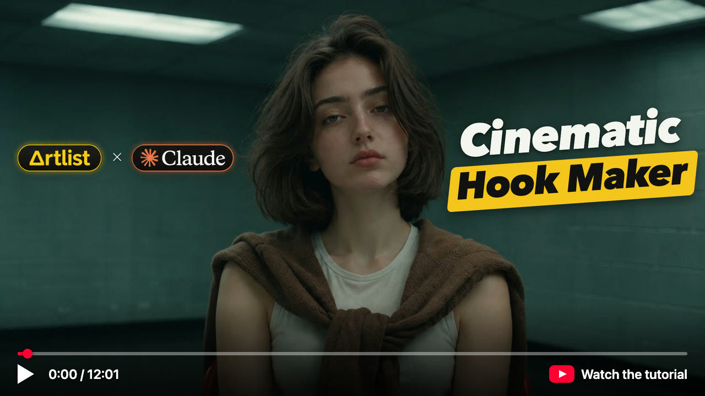

# The Cinematic Hook Maker

The first three seconds decide whether anyone watches the rest. The Cinematic Hook Maker designs and renders that opening like a film crew would: the story, the line that makes people stay, the first frame that stops the scroll, the camera, light and motion, and the on-screen text that works with the sound off. It renders with Kling 4.0 and GPT Image 2.5 through your Artlist account. When you need more than a hook, the same studio makes the whole film.

## Video tutorial

[](https://www.youtube.com/watch?v=RMIVe8mMIgE)

**[Kling 4.0 + Claude: Make AI Video Ads with 100 Viral Hooks (Free Skill)](https://www.youtube.com/watch?v=RMIVe8mMIgE)** (12 min) shows the whole workflow: connect Artlist to Claude, install the skill and make a hook for a TikTok affiliate ad with Kling 4.0, from the brief to the final render. Click a time to jump straight to that step.

**Set up (once)**
- [06:47](https://www.youtube.com/watch?v=RMIVe8mMIgE&t=407s) Connect Artlist to Claude through MCP
- [07:36](https://www.youtube.com/watch?v=RMIVe8mMIgE&t=456s) Install the Cinematic Hook Maker

**Make a hook**
- [08:20](https://www.youtube.com/watch?v=RMIVe8mMIgE&t=500s) Start the skill and upload your ad
- [09:08](https://www.youtube.com/watch?v=RMIVe8mMIgE&t=548s) Answer the brief
- [09:29](https://www.youtube.com/watch?v=RMIVe8mMIgE&t=569s) Pick a scored hook
- [09:51](https://www.youtube.com/watch?v=RMIVe8mMIgE&t=591s) Design the first frame
- [10:14](https://www.youtube.com/watch?v=RMIVe8mMIgE&t=614s) Render: Kling 4.0 Flash preview, then Kling 4.0
- [10:40](https://www.youtube.com/watch?v=RMIVe8mMIgE&t=640s) Final result: hook + ad

**Also in the video**
- [00:00](https://www.youtube.com/watch?v=RMIVe8mMIgE&t=0s) Kling 4.0 AI ad demo
- [01:00](https://www.youtube.com/watch?v=RMIVe8mMIgE&t=60s) How the Cinematic Hook Maker works
- [01:36](https://www.youtube.com/watch?v=RMIVe8mMIgE&t=96s) Artlist: 100+ AI models in one place
- [02:36](https://www.youtube.com/watch?v=RMIVe8mMIgE&t=156s) Kling 4.0 features explained
- [03:26](https://www.youtube.com/watch?v=RMIVe8mMIgE&t=206s) Why use Claude for AI video
- [04:00](https://www.youtube.com/watch?v=RMIVe8mMIgE&t=240s) Creative AI ad with Kling 4.0
- [04:52](https://www.youtube.com/watch?v=RMIVe8mMIgE&t=292s) Kling 4.0 vs Kling 4.0 Flash
- [05:45](https://www.youtube.com/watch?v=RMIVe8mMIgE&t=345s) AI affiliate ad (product review)

## What it does

**Hooks**
- Guided brief: just say "make a hook for my video about X" and it walks you through twelve short steps, one question at a time with clickable options (format by aspect ratio, video type, what the video delivers, language, audience gender and age, who is on screen, the AI model (female or male, with looks for your market), look, hook direction, on-screen text, sound, length and render plan). Each choice shapes the next options, "default" skips a step, "back" changes the last one, your usual answers come first next time, the language you choose sets the target market, and the AI model can be any look (Japanese, Korean, American, Latina, European and more) from a dropdown
- Knows seven platforms (TikTok, Reels, Shorts, YouTube, Facebook, LinkedIn, X), their ratios, hook windows and safe zones
- Knows twelve video types and what a hook must do for each
- Writes three different concepts from twelve story types, one hundred numbered opening lines and sixteen visual formats, and scores each for stopping power, clarity and payoff
- Every spoken line comes from the library: only its slots are filled, or it is translated faithfully. The helper script refuses a concept whose line was made up
- Designs a real, good-looking first frame that also works as the cover
- Renders with action from the very first frame and an ending that cuts straight into your video
- Burns exact on-screen text inside the safe zone, crops for 4:5, makes text-only A/B variants, swaps in a voice-over and joins the hook to your video
- Hands you a hook pack with every concept, frame, line, text, score and prompt

**Cinematic studio**
- Casting: models and presenters for your product, from your real product photos, with casting photos and character sheets that keep the face consistent
- A full photographic realism recipe for stills: attractive people in real, unretouched photographs
- A film-language library: shot size, angle, camera move, lens, light, colour, atmosphere, pace and transitions, plus genre presets that lock one look across every shot
- Multi-shot hooks, short films, micro-drama episodes, trailers, music videos and brand films: story beats, shot cards, prompt packs, storyboard board and pitch board
- One continuous take up to thirty seconds with keyframes
- VFX on your own footage: swap the person, outfit, product or background, add an effect, copy a camera move
- Dialogue in several languages, voice-over, music and sound effects
- Review and fix catalogue, cost report, edit list, rough cut and an episode handoff so a series stays consistent
- Remembers your platform, language, look and characters for next time

## Install

The skill needs the **Artlist connector** for every image and video. Connect it first: in the Claude desktop app, open **Customize → Connectors → Add custom connector**, name it `Artlist`, paste `https://mcp.artlist.io/mcp` as the server URL, then sign in to Artlist and accept. Watch it at [06:47](https://www.youtube.com/watch?v=RMIVe8mMIgE&t=407s).

### Claude desktop app (plugin)

The route shown in the video at [07:36](https://www.youtube.com/watch?v=RMIVe8mMIgE&t=456s):

1. Copy the plugin address:

   ```
   https://github.com/aitools-arena/cinematic-hook-maker.git
   ```

2. In the Claude desktop app, open **Customize → Plugins → Add marketplace → Add from a repository**, paste the address and click **Install** on the Cinematic Hook Maker.
3. Open the **Code** tab, choose a project folder (for example an "AI Video Project" folder with your ad and product photos) and start a new session. Type `/` and pick Cinematic Hook Maker.

### Claude Code (plugin)

In Claude Code, run:

```
/plugin marketplace add aitools-arena/cinematic-hook-maker
/plugin install cinematic-hook-maker@cinematic-hook-maker
```

Update later with `/plugin marketplace update cinematic-hook-maker`.

### Claude Code (manual)

```bash
git clone https://github.com/aitools-arena/cinematic-hook-maker.git
cp -R cinematic-hook-maker/plugins/cinematic-hook-maker/skills/cinematic-hook-maker ~/.claude/skills/
```

### claude.ai or Claude desktop (skill file)

1. Download `cinematic-hook-maker.skill` from the [latest release](https://github.com/aitools-arena/cinematic-hook-maker/releases/latest).
2. Settings → Capabilities → turn on code execution, then under Skills choose **Upload skill** and pick the file.

### Optional tools

Python 3 runs the helper scripts. `ffmpeg` and a Chrome-family browser are needed for burned-in text, crops and joining the hook to your video (`brew install ffmpeg` on macOS).

## Try it

- "Make a hook for my TikTok tutorial: how I made a sci-fi short with AI in one afternoon."
- "Three hook ideas for an Instagram ad for my handmade candles. Here's a photo of the candle."
- "Create a model for my fashion brand: Japanese, female, 20, wearing these clothes."
- "Swap the person in this product video for my model and keep the camera move."
- "A 15-second cold open for episode one of my micro-drama, three shots."

Generations use your own Artlist plan. Claude quotes the cost of each step before it renders anything.

## FAQ

**What does the Cinematic Hook Maker do?**
It turns Claude into a hook director for tutorials, reviews, vlogs, podcasts and ads. It runs a short brief with clickable options, adapts three hook ideas from a library of 100 opening lines, scores them for stopping power, clarity and payoff, designs a realistic first frame, renders the hook with Kling 4.0 on Artlist and joins it to the front of your video.

**Is it free?**
Yes. The skill is free under CC BY-NC 4.0. Images and videos are generated with your own Artlist plan, and Claude quotes the cost before it renders anything.

**Can Claude make videos?**
Yes, through the Artlist connector (MCP). Claude plans the shots and writes the prompts, and Artlist's AI models, including Kling 4.0 and GPT Image 2.5, generate the images and videos in the same chat. Everything is saved to your Artlist account.

**How do I connect Artlist to Claude?**
In the Claude desktop app, open Customize → Connectors → Add custom connector, name it Artlist, paste `https://mcp.artlist.io/mcp`, then sign in to Artlist and accept. Connecting is free.

**How do I install a Claude skill from GitHub?**
Copy the plugin address from [Install](#install), then in the Claude desktop app open Customize → Plugins → Add marketplace → Add from a repository, paste it and click Install. Open the Code tab, choose a project folder and start a new session.

**Which AI models does it use?**
Kling 4.0 for video (Kling 4.0 Flash for quick previews) and GPT Image 2.5 for stills, all through Artlist.

## License

[CC BY-NC 4.0](LICENSE): free to use and adapt with credit, not for commercial resale.
